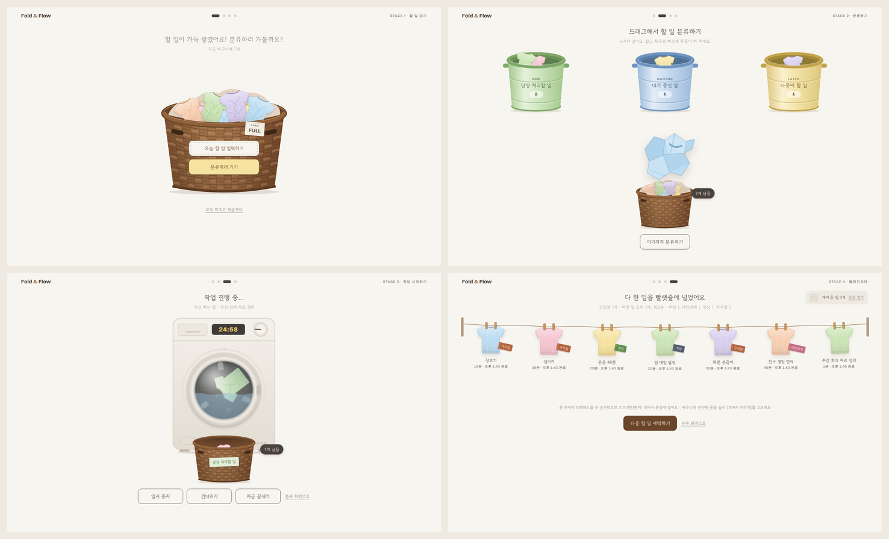

# Fold & Flow

빨래하듯 할 일을 담고, 나누고, 해치우고, 개어 두는 인터랙티브 할 일 웹앱입니다.



윗줄 왼쪽부터 스테이지 1 바구니 담기, 스테이지 2 분류하기, 아랫줄 왼쪽부터 스테이지 3 세탁기, 스테이지 4 빨래건조대입니다.

## 컨셉

할 일은 빨래와 닮았습니다. 미루면 쌓이고, 오래 두면 묵고, 나눠서 돌려야 하고, 끝낸 뒤에는 널고 개어 둔 다음 다시 꺼내 입습니다. Fold & Flow는 이 흐름을 할 일 관리에 그대로 옮겨, 적기·고르기·해내기·돌아보기를 손으로 만지는 물리적 동작으로 바꿨습니다.

| 스테이지 | 빨래 행위 | 할 일에서의 의미 |
| --- | --- | --- |
| 1. 바구니 담기 | 벗어 둔 옷을 바구니에 던져 넣기 | 생각나는 할 일을 거르지 않고 전부 적기 |
| 2. 분류하기 | 구겨진 옷을 펴고 먼지를 털어 통별로 나누기 | 내용을 확인하고 당장·대기·나중으로 우선순위 정하기 |
| 3. 작업 시작하기 | 세탁기에 넣고 시간 맞춰 돌리기 | 한 번에 한 가지에 시간을 정해 집중하기 |
| 4. 빨래건조대 | 널고, 라벨 보고, 개어 옷장에 넣기 | 끝낸 일을 돌아보고 분야별로 쌓기, 반복되는 일은 다시 꺼내 입기 |

## 사용 방법

### 스테이지 1 · 바구니 담기
1. [오늘 할 일 입력하기]를 누르면 티셔츠 입력창이 뜹니다. 할 일은 최대 3줄까지 적을 수 있습니다.
2. [완료]를 누르면 티셔츠가 구겨지며 바구니로 빨려 들어갑니다. [다음 할 일 꺼내기]는 바로 새 티셔츠를 띄웁니다.
3. 6개 이상 담으면 [분류하러 가기]가 켜집니다.

### 스테이지 2 · 분류하기
1. 바구니를 누르면 빨랫감 하나가 구겨진 채 작업대로 올라옵니다.
2. 잡은 채 좌우로 빠르게 흔들면 0.5초 만에 펴지며 메모가 보입니다.
3. 3일 넘게 확인하지 않은 할 일에는 먼지가 쌓여 있습니다. 한 번 누르면 털어집니다.
4. 확인한 빨랫감을 [당장 처리할 일]·[대기 중인 일]·[나중에 할 일] 통으로 끌어다 넣습니다.
5. 통을 누르면 담긴 빨래를 카드로 넘겨 보고, [다시 꺼내기]로 재분류할 수 있습니다.

### 스테이지 3 · 작업 시작하기
1. '당장 처리할 일' 바구니에서 빨랫감을 집어 세탁기 드럼 안으로 끌어다 놓습니다.
2. 타이머 팝업에서 5분 단위(5~120분)로 시간을 정하고 [세탁 시작]을 누릅니다.
3. 세탁 중에는 [일시 중지]·[건너뛰기]·[지금 끝내기]를 쓸 수 있습니다.
4. 시간이 끝나면 [다시 세탁하기] 또는 [할 일 완료]를 고릅니다. 완료하면 빨래건조대로 넘어갑니다.

### 스테이지 4 · 빨래건조대와 옷장
1. 옷을 누르고 [라벨 달기]로 7가지 라벨(학업, 일상, 루틴, 대인관계, 직장, 여가생활, 가사일) 중 하나를 붙입니다.
2. 옷을 좌우로 끌어 자리를 바꿉니다. 줄이 출렁이며 반응합니다.
3. 옷 위에서 트랙패드를 두 손가락으로 오므리면(핀치) 개어서 옷장에 넣습니다. 마우스만 쓴다면 옷을 눌러 [개어서 치우기]를 고릅니다.
4. 오른쪽 위 선반을 누르면 옷장이 열립니다. 라벨별 칸에 쌓인 높이로 어느 분야에 시간을 썼는지 보고, [다시 입기]로 할 일을 바구니에 되돌립니다.

### 키보드

| 키 | 동작 |
| --- | --- |
| ← / → | 이전·다음 스테이지 (건조대에서 옷에 포커스가 있으면 자리 이동) |
| Ctrl + Enter | 할 일 입력 완료 |
| Enter | 작업대 빨랫감 먼지 털기·펴기, 건조대 옷 라벨 팝업 |
| 1 / 2 / 3 | 작업대 빨랫감을 해당 통에 넣기 |
| ↑ | 건조대 옷 개어서 치우기 |
| Esc | 팝업 닫기 |

## 실행하기

빌드 과정이 없는 단일 HTML 파일입니다.

- **로컬:** `index.html`을 브라우저로 엽니다.
- **GitHub Pages:** 저장소 Settings → Pages에서 배포 브랜치를 `main`, 폴더를 `/ (root)`로 지정합니다.

데스크톱 브라우저(Chrome, Edge, Safari, Firefox 최신 버전)를 기준으로 만들었습니다. 핀치는 Chrome·Edge·Firefox의 트랙패드, Safari의 트랙패드, 터치스크린 두 손가락을 지원합니다.

## 데이터 저장

할 일과 진행 상황은 브라우저 `localStorage`의 `yme.v2` 키에 저장되며 서버로 전송되지 않습니다. 같은 브라우저에서만 유지되고, 브라우저 데이터를 지우면 사라집니다. 스테이지 1의 "모두 지우고 처음부터"로 초기화할 수 있습니다.

다른 코드에서 상태를 읽을 수 있도록 `window.YouMemo.getTasks()`, `window.YouMemo.getWash()`, `window.YouMemo.goTo(stage)`와 `yme:stagechange` 이벤트를 제공합니다.

## 기술

- HTML, CSS, JavaScript 단일 파일 (라이브러리·빌드 도구 없음)
- 그래픽: 인라인 SVG, CSS 3D transform
- 애니메이션: CSS Keyframes, Web Animations API
- 폰트: Google Fonts (Gowun Dodum, Bricolage Grotesque)

## 파일 구조

```
.
├── index.html     # 앱 전체 (마크업, 스타일, 스크립트)
├── docs/
│   └── hero.png   # README 대표 이미지
├── .gitignore
└── README.md
```
